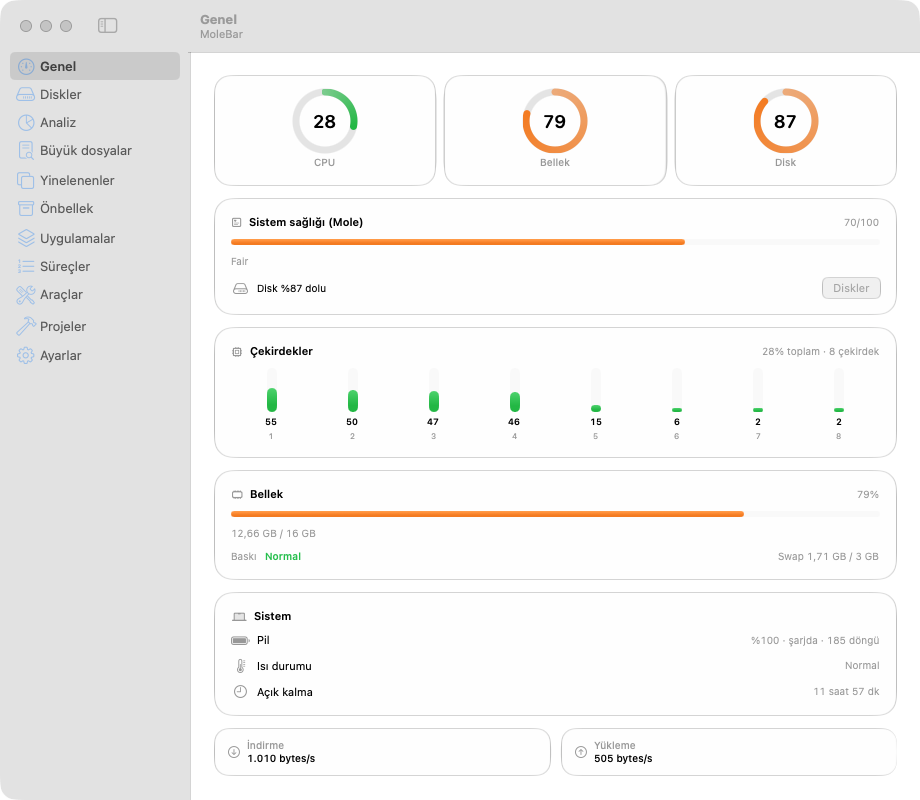

# MoleBar

MoleBar shows CPU, memory and disk usage in the macOS menu bar. It adds a clean-up and maintenance preview on top of [Mole](https://github.com/tw93/mole).

MoleBar is not an official Mole app. It was written for personal use. Mole is licensed under GPL-3.0.

The app interface is in Turkish. This file describes the app in English. The Turkish [README.md](README.md) is the primary document.

## License

MoleBar is MIT licensed. See `LICENSE`. Mole is a separate program. MoleBar runs it with the `mo` command. This repository does not contain Mole code.

## Requirements

- macOS 15 or later. The Liquid Glass look needs macOS 26 or later. Older versions use a fallback material.
- Swift 6 tools. Command Line Tools are enough. Xcode is not required.
- Mole: `brew install mole`. Without Mole, the health score, clean-up and maintenance preview do not work.

## Install

1. Open the repository folder: `cd mole`
2. Install: `./install.sh`

The script builds the app, copies it to `/Applications/MoleBar.app` and opens it. To build only, run `./make-app.sh`.

To install without building, use Homebrew:

1. Add the repository: `brew tap osmanbarutcu/mole-bar https://github.com/osmanbarutcu/mole-bar`
2. Install: `brew install --cask molebar`

The cask install is not verified on this machine.

A prebuilt zip is on the Releases page. It is ad-hoc signed and not notarized. On first launch, right-click the app and choose Open.

## Usage

- Click the text in the menu bar. A panel opens with General, Disks, Processes and Tools.
- Double-click the app to open the main window. Pages: General, Disks, Analyze, Large files, Duplicates, Cache, Apps, Processes, Tools, Projects, Settings.
- `⌥⌘M` opens or closes the main window. macOS 27 does not let an app open the menu bar panel from code.
- Settings has the menu bar style (text, icon or graph), the disk alert threshold, launch at login and the weekly scan.

## Features

- General: CPU, memory, disk, cores, battery health (maximum capacity), CPU and GPU temperature. Fan speed shows only on Macs with fans.
- Analyze: list view or treemap view. The Analyze and Large files lists export to CSV. You choose the path in the save dialog.
- Apps: uninstall and orphan leftovers (`~/Library` leftovers of apps that are no longer installed). Items move to the Trash.
- Tools: listening ports, outbound connections per process, Homebrew updates (check only, the command is copied to the clipboard).
- A notification appears once when memory pressure turns critical. Clicking a notification opens the related page.
- Optional update check against GitHub Releases. It is off by default.

## Safety

- The clean-up preview (`mo clean --dry-run`) deletes nothing.
- Real clean-up runs only after you confirm. It deletes user-level files only and cannot be undone.
- MoleBar moves items to the Trash. It never deletes permanently, except "Empty Trash", which asks for its own confirmation.
- The home folder's direct children, Mail, Messages, Keychains, iCloud and credential folders are protected.
- Docker, OrbStack, Mail and Spotlight data are shown only. MoleBar does not delete them.
- Homebrew updates are not run by MoleBar. It only copies the command.
- Connection addresses stay on your Mac. No country lookup is made.
- The update check, when you turn it on, sends one request a day to `api.github.com`. GitHub sees your IP address. No data is sent and nothing is downloaded.

## Known limits

- The app is signed with a local Apple Development certificate. Without one, an ad-hoc signature is used. Gatekeeper can warn on another Mac.
- Disk analysis and the Large files page need Full Disk Access for some folders. The number of unreadable items is shown. Without the permission, results are incomplete.
- The shortcut opens the main window, not the menu bar panel.
- Several UI paths are verified by tests only. See [docs/MANUAL-CHECKS.md](docs/MANUAL-CHECKS.md) for the manual steps.

## Development

- Build a DMG: run `./make-app.sh`, then `./scripts/make-dmg.sh`. The output is `dist/MoleBar-<version>.dmg`. The app is ad-hoc signed and not notarized. Opening the DMG on another Mac is not verified.
- Run the tests: `swift test`. Tests use Swift Testing (`Tests/MoleBarTests`). XCTest is not required.
- If `swift test` reports a `TestingMacros` plugin error, run: `swift test -Xswiftc -plugin-path -Xswiftc /Library/Developer/CommandLineTools/usr/lib/swift/host/plugins/testing`.
- To see the panel in a window: `MOLEBAR_PANEL_PREVIEW=1 /Applications/MoleBar.app/Contents/MacOS/MoleBar`.
