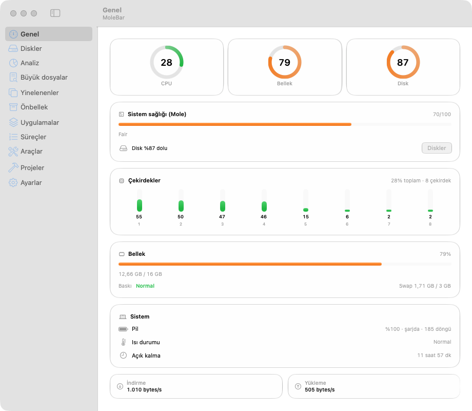

# MoleBar

[English README](README.en.md)

MoleBar, macOS menü çubuğunda CPU, bellek ve disk kullanımını gösterir. [Mole](https://github.com/tw93/mole) ile temizlik ve bakım önizlemesi sunar.

MoleBar, Mole'un resmi uygulaması değildir. Kişisel kullanım için yazıldı. Mole GPL-3.0 lisanslıdır.

## Lisans

MoleBar MIT lisanslıdır. Ayrıntı `LICENSE` dosyasındadır. Mole ayrı bir programdır. MoleBar onu `mo` komutuyla çalıştırır. Mole kodu bu depoda yoktur.

## Gereksinimler

- macOS 15 veya üstü. Liquid Glass görünümü macOS 26 ve üstünde çalışır. Eski sürümde yedek materyal kullanılır.
- Swift 6 araçları (Command Line Tools yeterlidir, Xcode gerekmez).
- Mole: `brew install mole`. Mole yoksa sağlık skoru, temizlik ve bakım önizlemesi çalışmaz.

## Kurulum

1. Depoyu açın: `cd mole`
2. Kurun: `./install.sh`

Betik uygulamayı derler, `/Applications/MoleBar.app` altına kopyalar ve açar. Yalnızca derlemek için `./make-app.sh` çalıştırın.

Derlemeden kurmak için Homebrew kullanın:

1. Depoyu ekleyin: `brew tap osmanbarutcu/mole-bar https://github.com/osmanbarutcu/mole-bar`
2. Depoya güvenin: `brew trust osmanbarutcu/mole-bar`. Homebrew 7 bu adım olmadan cask'ı yüklemez.
3. Kurun: `brew install --cask osmanbarutcu/mole-bar/molebar`

Uygulama ad-hoc imzalıdır ve notarize edilmemiştir. İlk açılışta sağ tık > Aç gerekir. Cask kurulumu doğrulanmadı. `brew tap` çalıştı. `brew trust` ve kurulum çalıştırılmadı.

## Kullanım

- Menü çubuğundaki metne tıklayın. Panel açılır: Genel, Diskler, Süreçler, Araçlar.
- `⌥⌘M` ana pencereyi açar veya kapatır. macOS 27 menü çubuğu panelini koddan açmaya izin vermez.
- Uygulamayı çift tıklayın. Ana pencere açılır: Genel, Diskler, Analiz, Büyük dosyalar, Yinelenenler, Önbellek, Uygulamalar, Süreçler, Araçlar, Projeler, Ayarlar.
- Ayarlar'da menü çubuğu görünümü (metin, ikon veya CPU grafiği), disk uyarı eşiği, girişte başlatma ve haftalık tarama bulunur.

## Özellikler

- Genel: CPU, bellek, disk, çekirdekler, pil sağlığı (azami kapasite), CPU/GPU sıcaklığı. Fan hızı yalnızca fanlı Mac'lerde görünür.
- Analiz: liste veya treemap harita görünümü. Analiz ve Büyük dosyalar listesi CSV olarak kaydedilir. Kaydetme penceresinde yolu siz seçersiniz.
- Uygulamalar: kaldırma ve yetim artıklar (kurulu uygulaması olmayan `~/Library` kalıntıları, Çöp Kutusu'na taşınır).
- Araçlar: açık portlar, dış bağlantılar (süreç başına), Homebrew güncellemeleri (yalnızca denetim, komut panoya kopyalanır).
- Kritik bellek baskısında bir kez bildirim gelir. Bildirime tıklayınca ilgili sayfa açılır.

## Doğrulama

Otomatik test kapsamayan adımlar [docs/MANUAL-CHECKS.md](docs/MANUAL-CHECKS.md) dosyasındadır. Sürüm öncesi çalıştırın.

## Güvenlik

- Temizlik önizlemesi (`mo clean --dry-run`) hiçbir şey silmez.
- Gerçek temizlik yalnızca onaydan sonra çalışır. Yalnızca kullanıcı seviyesi dosyaları siler. Geri alınamaz.
- Disk analizi salt okunurdur. Çöp ikonu öğeyi Çöp Kutusu'na taşır. Ev klasörünün doğrudan alt öğeleri korunur.
- Yinelenenler sayfası ev klasöründe (gizli klasörler ve ~/Library hariç) aynı içerikli dosyaları SHA-256 ile bulur. Taşıma Çöp Kutusu'nadır. Her gruptaki son kopya taşınamaz.
- Diskler sayfasındaki "Kazanılabilir alan" kartı, son taramaların sonucunu gösterir. Kategoriler çakışabilir, toplam yoktur.
- Önbellek sayfası; uygulama önbelleklerini, günlükleri ve geliştirici önbelleklerini listeler. Seçilenler Çöp Kutusu'na taşınır. "Çöp Kutusu'nu boşalt" kalıcıdır ve ayrı onay ister.
- Yinelenenler sayfasında "Gizli klasörleri ve Library'yi de tara" anahtarı vardır. Varsayılan kapalıdır.
- Genel sayfasında pil, ısı durumu ve açık kalma süresi görünür. Mac 30 günden uzun açıksa uyarı çıkar.
- Süreçler sayfası CPU, Bellek ve Ağ sıralaması sunar.
- Önbellek sayfası OrbStack/Docker, Mail ve Spotlight dizini boyutunu yalnızca gösterir. MoleBar bunları silmez. Boyut hesabı sert bağlantıları bir kez sayar.
- Araçlar sayfası hedefi eksik giriş öğelerini listeler. Silmez.
- Projeler sayfası ev klasöründe ve bağlı disklerde yeniden üretilebilir proje çıktılarını bulur: `node_modules`, `.build`, `vendor`, `target`, `Pods`, `.venv`. Klasör yalnızca yanında proje dosyası varsa listelenir (örn. `package.json`). Son etkinlik; manifest, `.git` ve klasör tarihinin en yenisidir. Taşıma Çöp Kutusu'nadır. Sonra yeniden kurulum gerekir. Birden fazla disk varsa sayfa her diski ayrı seçenek olarak gösterir (disk başına toplamla). "Hepsi" seçiliyken liste disk başlıklarıyla gruplanır.
- Diskler sayfasındaki "Disk neden dolu?" kartı her diski ayrı bölümde anlatır. Ana diskte kapsayıcılar, önbellek, Çöp Kutusu ve proje çıktıları, diğer disklerde proje çıktıları görünür. Büyük dosyalar listesi OrbStack ve Spotlight dosyalarını da içerdiği için karta eklenmez.
- Ayarlar sayfasında tema, son işlemler ve son hatalar bulunur. Son işlemlerde "Geri al" dosyayı Çöp Kutusu'ndan özgün yerine koyar. Hedefte aynı adlı öğe varsa, özgün klasör yoksa veya dosya Çöp Kutusu'nda değilse geri almaz. Ana pencerede ⌘1–⌘9 sayfa değiştirir, Ayarlar için ⌘0. Projeler sayfasının kısayolu yoktur.
- Uygulamalar sayfası, uygulamayı ve `~/Library` artıklarını Çöp Kutusu'na taşır. Çalışan uygulama engellenir. Kalıcı silme yoktur.
- Süreç sonlandırma `SIGTERM` gönderir. Sistem süreçleri korunur.
- Gerçek `mo optimize` Terminal'de çalışır, çünkü yönetici izni ister.
- Korunan yollar `mo clean --whitelist` ile Terminal'de yönetilir. Uygulama bu dosyayı yazmaz. Dosya varsa Mole'un varsayılan korumalarını değiştirir.

## Bilinen sınırlar

- Uygulama yerel Apple Development sertifikasıyla imzalanır. Sertifika yoksa ad-hoc imza kullanılır. Başka bir Mac'e kopyalarsanız Gatekeeper uyarı verebilir.
- ⌥⌘M kısayolu varsayılan olarak menü çubuğu panelini değil, ana pencereyi açar. macOS 27 `MenuBarExtra` panelini koddan açmaya izin vermez. Ayarlar'daki "Özel menü çubuğu öğesi (deneysel)" anahtarı kendi `NSStatusItem` ve `NSPopover` öğemizi kurar. Açıkken kısayol gerçek paneli açar. Değişiklik için yeniden başlatın. Panel kısayolla açma ekran görüntüsüyle doğrulandı, gerçek tuş basışı doğrulanmadı.
- Yeni sürüm denetimi isteğe bağlıdır ve varsayılan kapalıdır. Açarsanız günde en çok 1 kez api.github.com adresine istek gider. GitHub IP adresinizi görür.
- Arayüz yalnızca Türkçedir. İngilizce yerelleştirme yapılmadı.
- Disk analizi ve Büyük dosyalar sayfası, bazı klasörler için Tam Disk Erişimi ister. Erişilemeyen öğe sayısı ekranda görünür. İzin yoksa sonuçlar eksik kalır. Örnek: 426 bin dosya görüldü, izinli betik 626 bin dosya gördü.
- `mo purge` Mole'da hata verebilir (`discovered[@]: unbound variable`). Doğrulanmadı.
- Gerçek `mo clean` çıktı biçimi doğrulanmadı. Boşalan alan diskten ölçülür.

## Geliştirme

- Sürüm çıkarmak için: `Casks/molebar.rb` içindeki `version` ve `sha256` değerlerini güncelleyin. Sonra `git tag vX.Y.Z` ve `git push --tags` çalıştırın. `.github/workflows/release.yml` zip ve DMG üretip release'e yükler.
- DMG üretin: `./make-app.sh`, ardından `./scripts/make-dmg.sh`. Çıktı `dist/MoleBar-<sürüm>.dmg` dosyasıdır. Uygulama ad-hoc imzalıdır, notarize edilmez. İlk açılışta sağ tık > Aç gerekir. DMG'nin başka Mac'te açılışı doğrulanmadı.
- Simgeyi yeniden üretin: `swift scripts/make-icon.swift /tmp/AppIcon.iconset`, ardından `iconutil -c icns /tmp/AppIcon.iconset -o Resources/AppIcon.icns`.
- Testleri çalıştırın: `swift test`. Testler Swift Testing kullanır (`Tests/MoleBarTests`). XCTest gerekmez.
- `swift test` bazen `TestingMacros` eklenti hatası verir ve tekrar çalıştırmak yetmeyebilir. Kalıcı çözüm: `swift test -Xswiftc -plugin-path -Xswiftc /Library/Developer/CommandLineTools/usr/lib/swift/host/plugins/testing`.
- Panel görünümünü pencerede görmek için: `MOLEBAR_PANEL_PREVIEW=1 /Applications/MoleBar.app/Contents/MacOS/MoleBar`.
- Özel menü çubuğu öğesinde paneli 3 sn sonra açmak için: `defaults write local.molebar customStatusItem -bool true`, sonra `MOLEBAR_DIAG_POPOVER=1 /Applications/MoleBar.app/Contents/MacOS/MoleBar`.
- Ekran görüntüleri: `scripts/ui-shots.sh [klasör] [system|light|dark]`. Terminal için Erişilebilirlik izni gerekir.
